# Where's Whiskers: o que mudou

O app deixou de ser um quadro individual para montar cenas e virou um jogo em turma, com sala, turnos, pontos dados pelo professor, fases e pódio no final.

## Antes x agora

A mudança principal: antes cada pessoa brincava sozinha no próprio navegador; agora o professor conduz uma partida e todos os alunos jogam juntos, cada um no seu celular.

| Aspecto | Antes | Agora |
| --- | --- | --- |
| Quem usa | Uma pessoa, sozinha | Professor + turma inteira ao mesmo tempo |
| Login | Nenhum | Professor entra com senha; aluno entra com PIN da sala + nome |
| Entrada dos alunos | Não existia | QR code, link da sala ou PIN de 5 caracteres |
| Montar cenário | Qualquer um, com o gato junto | Só o professor, na aba Montar cena, e publica para a turma (o gato fica de fora) |
| Posicionar o gato | Livre, sem objetivo | O aluno da vez arrasta o gato e envia a resposta |
| Turnos | Não existiam | Cada aluno joga uma vez por fase, na ordem de entrada |
| Pontuação | Não existia | Professor dá 0, 25, 50 ou 100 pontos a cada resposta |
| Placar | Não existia | Painel lateral ao vivo (atualiza a cada 2 s), com setas ▲▼ de quem subiu ou desceu |
| Fases | Não existiam | Professor define de 1 a 20 fases; entre elas monta um cenário novo |
| Final | Não existia | Pódio animado com 1º, 2º e 3º lugar para todos |
| Onde a cena fica salva | Navegador (localStorage) | Rascunho do professor no navegador; cena publicada, jogadores e pontos no servidor |
| Visual | Título, quadro e lista de preposições | Estilo de jogo de quiz: cores fortes, PIN grande, botões coloridos de pontuação, telas enxutas, sem emojis e sem travessões |
| Lista de preposições | Menu lateral | Continua: menu lateral do professor e seção recolhível para o aluno |

## Como o jogo funciona agora

1. O professor entra com a senha e clica em **Gerar sala**. No lugar do login aparecem o PIN, o QR code e, embaixo, o link da sala. **Abrir painel da sala** leva ao jogo.
2. Os alunos já podem entrar antes do início: leem o QR code (ou digitam o PIN) e colocam o nome. Os nomes aparecem na sala de espera, na tela do professor. Nome repetido vira "Ana 2".
3. O professor escolhe quantas fases o jogo terá, monta o cenário da fase 1 e clica em **Publicar para a turma**.
4. Ao clicar em **Começar jogo**, começa a fase 1. O professor escreve a instrução (ex.: *Put Whiskers under the bed*) e o aluno da vez arrasta o gato e clica em **Enviar resposta**. Os outros veem de quem é a vez e a resposta enviada.
5. O professor vê onde o gato ficou e dá 0, 25, 50 ou 100 pontos. A vez passa sozinha para o próximo aluno que ainda não jogou na fase.
6. Depois do turno do último aluno, a fase termina. O professor monta e publica um cenário novo e clica em **Começar fase N**. O botão só libera depois de publicar o cenário novo.
7. Ao fim da última fase, o pódio aparece sozinho para todos, e cada aluno vê a própria posição. **Nova partida** zera os pontos e volta para a sala de espera.

Durante a partida o professor também pode pular o aluno da vez, escolher quem joga (só entre quem ainda não jogou na fase), remover um nome da sala ou encerrar o jogo antes. Quem entra no meio de uma fase joga nela também.

## As telas, passo a passo

Os prints abaixo são de uma partida real de teste, com 3 alunos fictícios (Ana, Bruno e Carla) e 2 fases, rodando no navegador. Bruno usou tela de celular. Antes, o app tinha uma única tela: o quadro de montar cena com a lista de preposições ao lado.

### 1. Página inicial

A primeira tela agora separa os dois papéis: à esquerda o aluno entra com PIN e nome, à direita o professor entra com a senha. O aviso embaixo lembra de trocar a senha padrão.

### 2. Professor logado

Depois do login, o professor clica em **Gerar sala**.

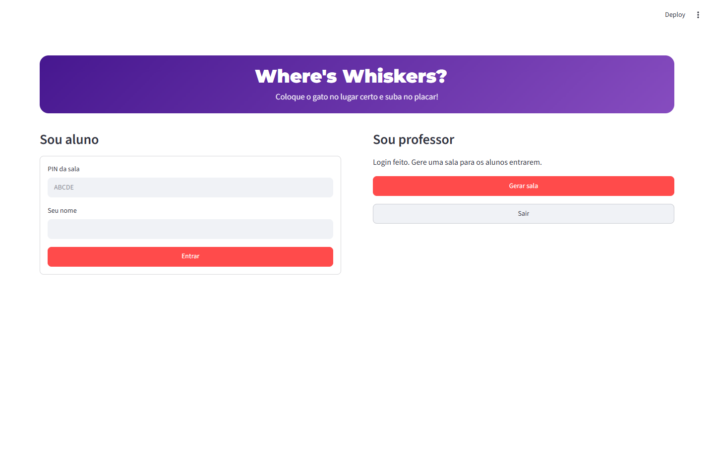

### 3. Sala gerada: QR code e link

No lugar do login aparece o PIN, o QR code e, embaixo, o link da sala (`https://whiskers-game.streamlit.app/?sala=PIN`). Os alunos leem o QR code ou abrem o link. O professor clica em **Abrir painel da sala** para conduzir o jogo.

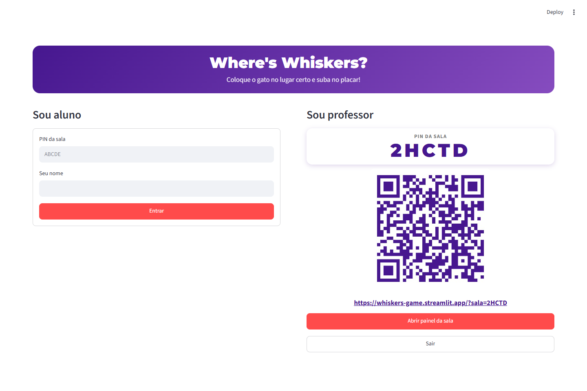

### 4. Aluno entrando pelo QR code

Quem lê o QR code cai direto nesta tela, com o PIN já vindo do link. O aluno só digita o nome.

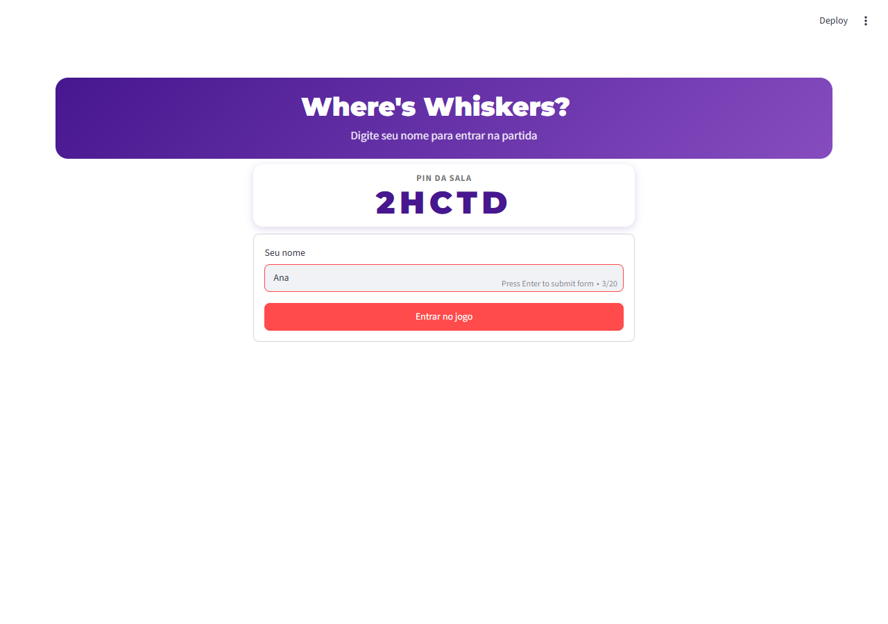

### 5. Aluno esperando o início (celular)

O aluno entra antes de o jogo começar e fica aguardando. A tela confirma o nome e já mostra o placar.

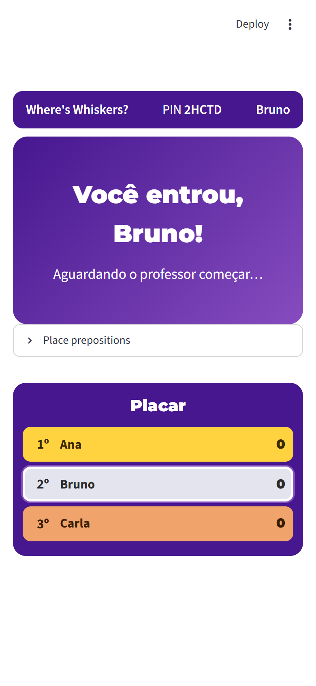

### 6. Professor monta o cenário

A aba **Montar cena** é o quadro antigo, agora só do professor. Ele arrasta móveis e objetos, sem o gato, e clica em **Publicar para a turma**.

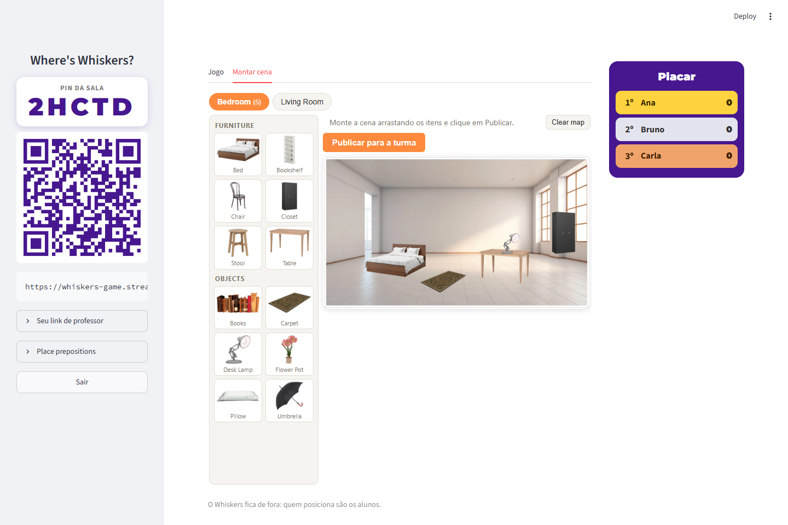

### 7. Sala de espera do professor

Tela para projetar na sala: PIN, QR code grande com o link embaixo, quantidade de alunos e o nome de cada um que entrou. O professor escolhe o número de fases e clica em **Começar jogo**. Ações menos usadas (mudar a instrução, escolher quem joga, remover aluno, encerrar) ficam em **Mais opções**, nesta e nas outras telas do professor.

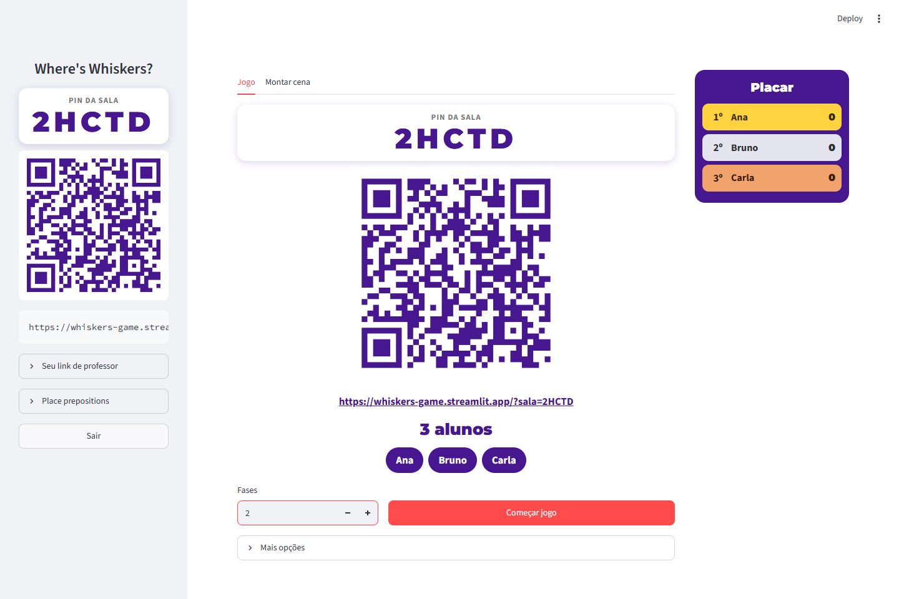

### 8. A vez do aluno

Só o aluno da vez vê o quadro interativo. Os móveis ficam travados, apenas o gato se move (Front, Back e Flip ajudam em "behind" ou "in front of"). Ele posiciona e clica em **Enviar resposta**.

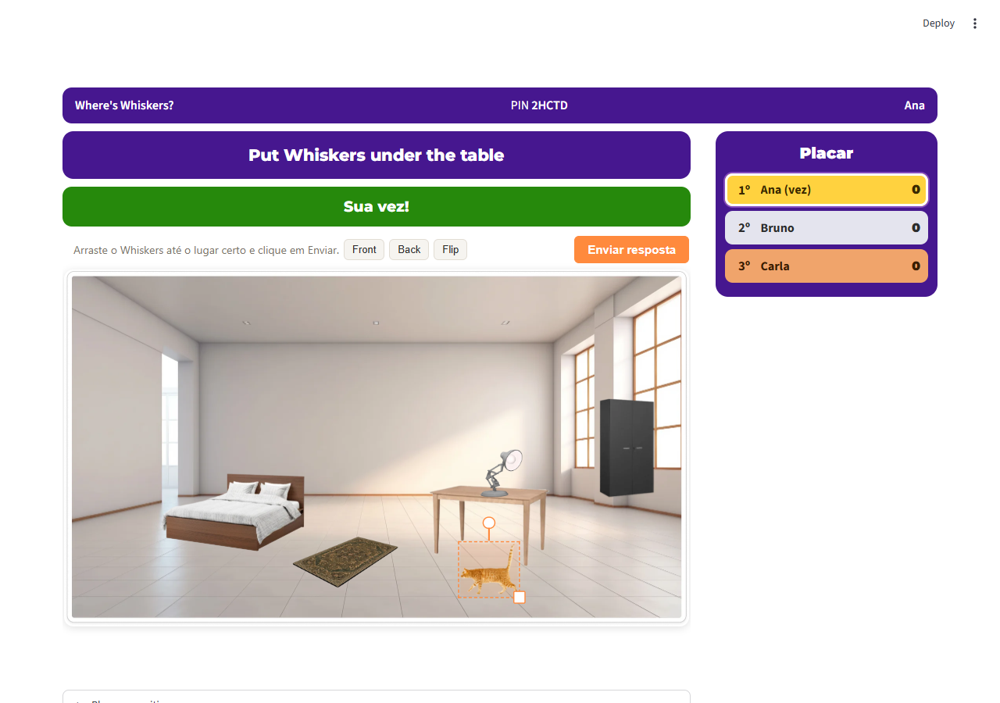

### 9. O que os outros alunos veem

Quem não está na vez acompanha: a fase, a instrução, quem respondeu e onde o gato foi colocado.

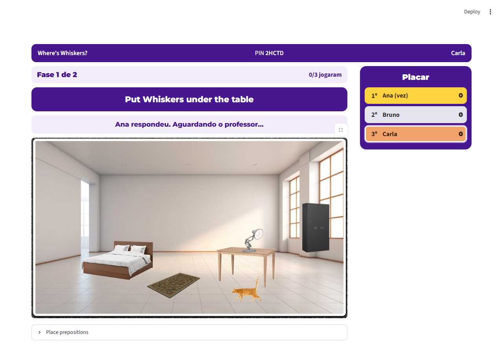

### 10. Professor avalia a resposta

O professor vê a cena com o gato onde o aluno deixou e escolhe a pontuação nos botões coloridos: 0, 25, 50 ou 100. Os botões só liberam depois que a resposta chega.

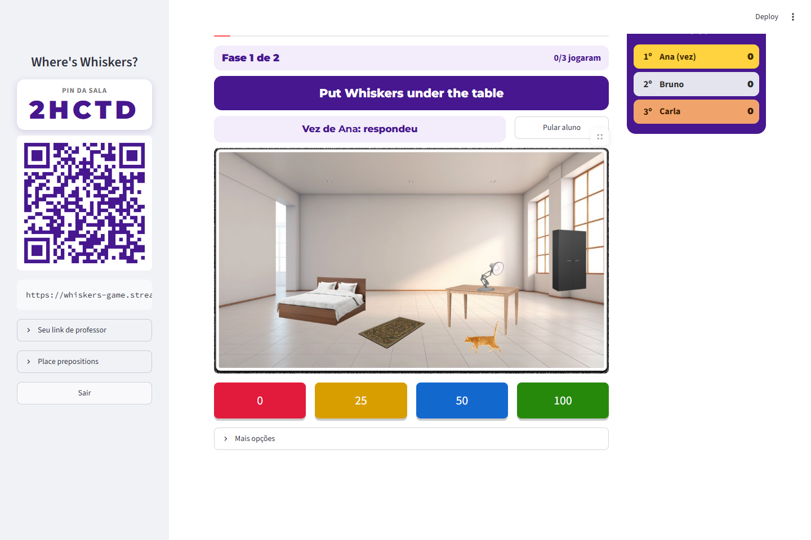

### 11. A vez no celular

No celular o quadro se ajusta à largura da tela e o gato é arrastado com o dedo.

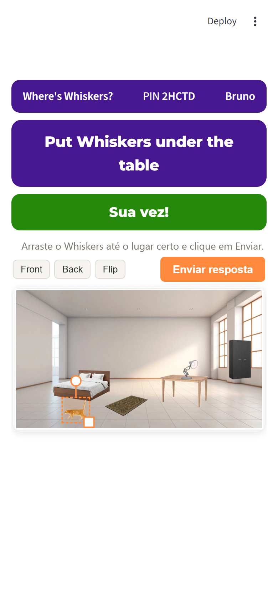

### 12. Fim da fase (professor)

Depois do último aluno a fase termina. O placar mostra quem subiu (▲) e quem desceu (▼), e o botão **Começar fase 2** fica bloqueado até o professor publicar um cenário novo na aba **Montar cena**.

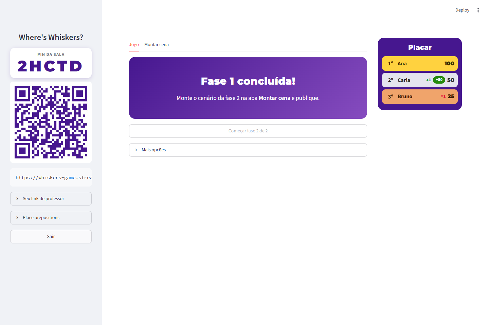

### 13. Fim da fase (aluno)

Enquanto o professor prepara a próxima fase, o aluno vê em que lugar está.

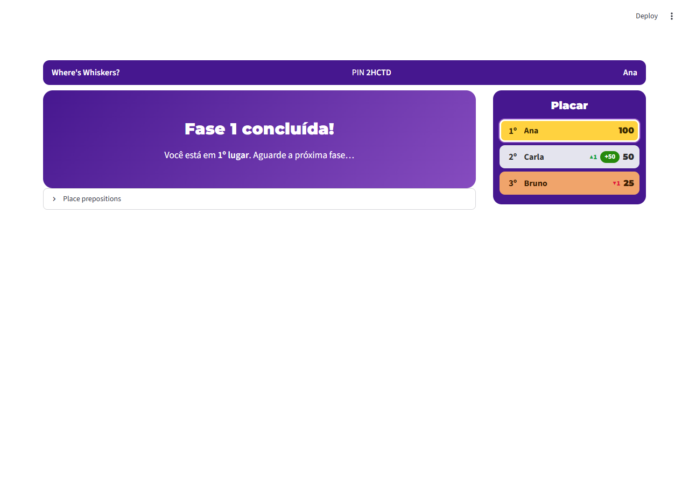

### 14. Cenário novo publicado

Com o cenário da fase 2 publicado (aqui, a sala de estar), o botão libera e o professor confere a prévia antes de começar.

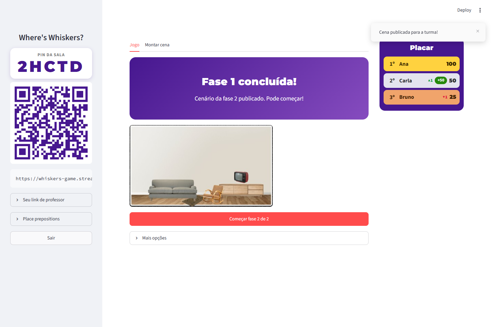

### 15. Placar mudando

Na fase 2, Ana errou (0) e Bruno acertou (100). O placar reordena sozinho: Bruno subiu duas posições e ganhou o selo +100.

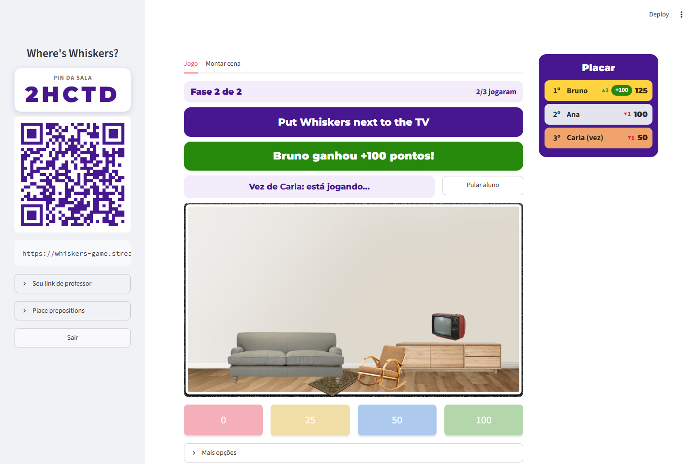

### 16. Pódio (professor)

No fim da última fase o pódio aparece sozinho, com os blocos subindo do 3º ao 1º. **Nova partida** zera os pontos e volta para a sala de espera.

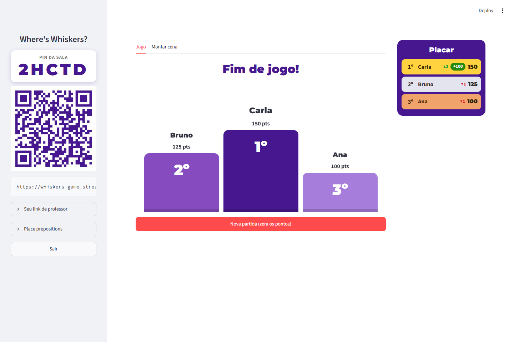

### 17. Pódio (aluno no celular)

Cada aluno vê o mesmo pódio e, logo abaixo, a própria posição e pontuação.

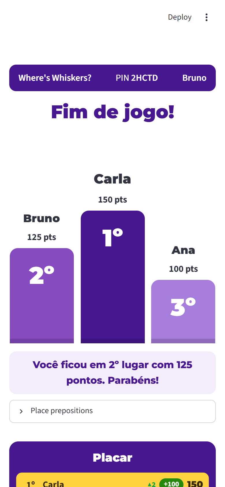

## Acesso e login

Só o professor tem senha; os alunos entram com o PIN da sala e o nome.

| Quem | Onde entra | Login |
| --- | --- | --- |
| Professor | Página inicial, opção *Sou professor* | Senha padrão `professor`, ou a definida em `TEACHER_PASSWORD` nos secrets do Streamlit Cloud |
| Aluno | QR code, link `https://whiskers-game.streamlit.app/?sala=PIN` ou página inicial, opção *Sou aluno* | Sem senha: PIN da sala + nome |

No painel da sala, o professor tem um link pessoal (menu lateral, *Seu link de professor*) para voltar à mesma sala; ele não deve ser passado aos alunos. O QR code e o link dos alunos sempre apontam para `https://whiskers-game.streamlit.app`; outro endereço pode ser definido em `APP_URL` nos secrets. Para rodar localmente: `pip install -r requirements.txt` e `streamlit run aplicacao.py`.

## Arquivos alterados

O código foi dividido em três módulos Python, e o quadro passou a mandar dados de volta para o Python.

| Arquivo | Situação | O que mudou |
| --- | --- | --- |
| `aplicacao.py` | Reescrito | Antes desenhava só o quadro e a lista de preposições. Agora tem as telas (início, entrada do aluno, professor, aluno, pódio) e a navegação pelos parâmetros da URL (`?sala=`, `&prof=`, `&aluno=`). Telas se atualizam sozinhas a cada 2 s. |
| `sala.py` | Novo | Estado compartilhado das salas: jogadores, ordem, vez, resposta, pontos, fases e status (lobby, jogando, intervalo, fim). Fica em memória, protegido por trava para várias sessões ao mesmo tempo. |
| `cenario.py` | Novo | Carregamento das imagens (saiu do `aplicacao.py`), o componente do quadro, a imagem estática da cena desenhada no servidor (para quem não está na vez) e o QR code. |
| `frontend/index.html` | Novo | Substitui `frontend/html/board.html` (apagado). Tem os botões novos *Publicar para a turma* e *Enviar resposta*. |
| `frontend/js/board.js` | Reescrito em boa parte | Antes só exibia. Agora conversa com o Streamlit nos dois sentidos e tem dois modos: editor (professor monta e publica) e jogador (aluno só move o gato e envia). |
| `frontend/css/board.css` | Ampliado | Estilos do modo jogador, itens travados e botões principais. |
| `frontend/css/streamlit.css` | Ampliado | Visual do jogo: cabeçalho, PIN, sala de espera, fases, placar, botões de pontuação coloridos e animações do pódio. |
| `requirements.txt` | Alterado | Streamlit a partir de 1.45 e a biblioteca `qrcode`. |
| `.gitignore` | Alterado | Ignora `__pycache__/` e `.streamlit/secrets.toml`. |
| `README.md` | Reescrito | Instruções de acesso, de jogo e de configuração. |
| `docs/` | Novo | Este documento e os prints das telas. |

As imagens em `assets/` não mudaram; cada pasta com `background.png` continua virando um mapa.

## Limitações e pontos de atenção

O ponto mais urgente é trocar a senha padrão antes de usar com uma turma.

- **Senha:** enquanto `TEACHER_PASSWORD` não for definida nos secrets, a senha é `professor`, e quem souber disso entra como professor.
- **Memória:** salas, jogadores e pontos ficam só na memória do servidor. Se o app reiniciar ou "dormir" no Streamlit Cloud, a sala some e é preciso criar outra. Salas expiram após 24 h.
- **Testes:** o fluxo completo foi testado no servidor (entrada, turnos, fases, pular, remover, pontuar, pódio, nova partida) sem erros. Uma partida inteira também foi jogada num navegador real (Edge), com professor e 3 alunos, um deles em tela de celular, e tudo funcionou sem erros; os prints acima são dessa partida. Ainda falta testar num celular de verdade, com o dedo.
- **Rascunho do professor:** o cenário em montagem fica salvo só no navegador de quem montou; em outro computador começa vazio.
- **Atualização:** as telas se atualizam a cada 2 s, então pode haver um pequeno atraso entre a ação do professor e o que o aluno vê.
